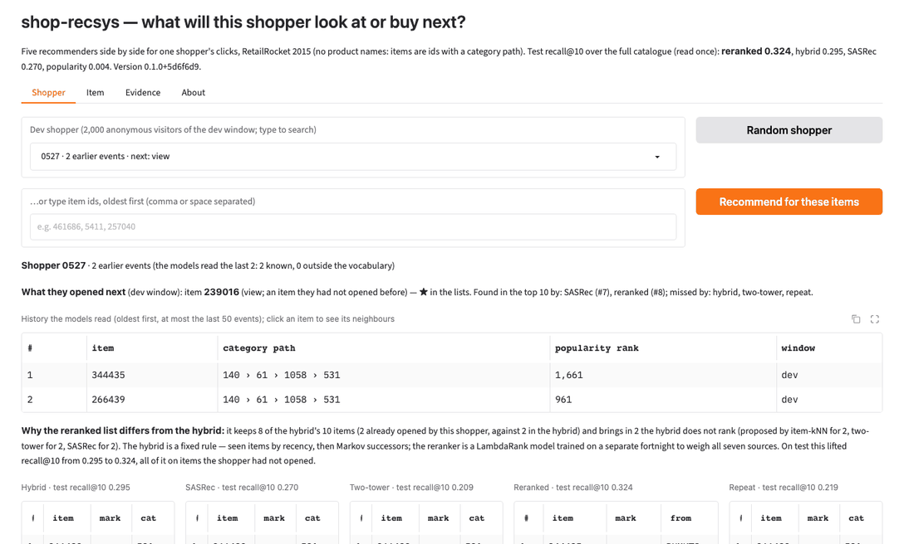

# shop-recsys

[](https://huggingface.co/spaces/DavutKursun/shop-recsys)
[](https://github.com/DavutKursun/shop-recsys/actions/workflows/ci.yml)

**Recommends what a shopper will look at or buy next, from clicks alone — and measures it the way a shop would feel it.**

**Live:** https://davutkursun-shop-recsys.hf.space (demo at `/ui`, API docs at `/docs`)



## The problem
A shop with hundreds of thousands of products cannot show them all; the products a shopper sees next decide whether
they buy. Recommenders are easy to build and easy to evaluate wrongly: random splits leak the future, sampled metrics
flatter weak models, and the baseline that is hardest to beat is rarely reported.

## What this does
- Two retrieval models written from scratch in PyTorch: a sequential transformer (SASRec, sampled softmax with 4,096
  uniform negatives) and a two-tower model (in-batch negatives with the logQ correction); exact FAISS search over the
  item vectors
- A LightGBM LambdaRank reranker over the union of seven sources' candidates, every candidate scored by every source
- Five classical baselines that must be beaten, including a repeat-then-Markov hybrid that is the real bar here
- Evaluation on a global time split, over the full catalogue, with visitor-bootstrap confidence intervals, paired
  differences, cold-start rows, and one look at the test window
- Served by FastAPI + Gradio on a Hugging Face Docker Space through the same code path the evaluation used

## Results (test window, read once; full catalogue; 95% visitor-bootstrap CIs)

| Metric (next item, 95,905 cases) | Best baseline (hybrid) | SASRec | Reranked pipeline |
|---|---|---|---|
| Recall@10 | 0.295 [0.286, 0.304] | 0.270 [0.261, 0.280] | **0.324 [0.315, 0.334]** |
| NDCG@10 | 0.206 | 0.183 | **0.235** |
| Paired difference vs hybrid, recall@10 | — | −0.025 [−0.028, −0.022] | **+0.029 [+0.028, +0.031]** |
| Coverage@10 / popularity quantile | 0.60 / 0.14 | 0.74 / 0.23 | 0.71 / 0.19 |
| First-click visitors, recall@10 (31,415 cases) | 0.253 | 0.274 | **0.292** |
| Purchases, recall@10 (635 cases) | **0.627** | 0.288 | 0.584 |

Every conclusion drawn on dev replicated on test with the same sign; every model lost about 0.03 recall@10 between
the two windows because the later fortnight has more products the vocabulary never saw. Popularity scores 0.004.
Live on the Space's 2 vCPUs, one `/recommend` with the reranker takes **34 ms server-side at the median**
(p95 54 ms, 30 calls; 11 ms on a laptop), a single model 2–5 ms.

**What does not work yet**
- Purchases: the reranker optimises clicks and finds 58% of purchases against the repeat lookup's 63%
- Cold items: the category path makes 97% of targets reachable but finds 0.04% of the newly reachable ones
- Out-of-vocabulary targets: 25.5% of test targets have fewer than five training events and no id model can rank them
- HNSW: not faster where it is accurate at 70k items, so exact search is served

With 100 sampled negatives, the protocol of many papers, SASRec and the two-tower "beat" the hybrid by 0.1 and
popularity reaches 0.32; over the full catalogue the hybrid leads both and popularity is 0.004. Every number here is
the full ranking. Design notes with every table: [docs/DESIGN.md](docs/DESIGN.md) · [model card](docs/model_card.md).

## Data
RetailRocket e-commerce events (2.76M views, add-to-carts and purchases by 1.41M visitors over 4.5 months of 2015;
item categories from the property files; no product names). Global time split: train → 14-day rerank window →
14-day dev → 14-day test.

## Run it yourself
```bash
pip install -r requirements-dev.txt
python scripts/fix_openmp_macos.py                    # macOS only, once per venv (see below)
pytest -q                                             # no data needed
python scripts/download.py                            # where to put the raw files
make dataset baselines sasrec two-tower index reranker eval-dev
make serving app                                      # export the served bundle, then the API + UI on :7860
```
On macOS, torch, faiss-cpu and lightgbm each ship their own OpenMP runtime, and two of them in one process abort or hang
Python at the first parallel region; the script points all three at torch's copy (rerun it after upgrading any of them).
On Linux (CI, the Docker image) nothing is needed: the image build runs all three together as a check.

## The live API
A history is a list of raw RetailRocket item ids, oldest first; the models read the last 50. An id outside the
69,784-item vocabulary is counted as unknown; a history with no known item gets the last training week's most popular
items, flagged as a fallback. Every item carries the sources that proposed it and whether the shopper saw it before.

```bash
curl -s -X POST https://davutkursun-shop-recsys.hf.space/recommend \
  -H 'Content-Type: application/json' -d '{"history": [447314, 458489], "k": 3}'
```
```json
{
  "items": [
    {"item": 458489, "score": 1.893797, "rank": 1, "category": 618, "category_path": "1224 › 105 › 618", "popularity_rank": 2669, "seen_before": true, "sources": ["repeat", "hybrid", "two_tower", "sasrec"]},
    {"item": 447314, "score": 1.860419, "rank": 2, "category": 72, "category_path": "140 › 540 › 1515 › 620 › 72", "popularity_rank": 35836, "seen_before": true, "sources": ["repeat", "hybrid", "sasrec"]},
    {"item": 169571, "score": 0.281487, "rank": 3, "category": 618, "category_path": "1224 › 105 › 618", "popularity_rank": 2525, "seen_before": false, "sources": ["hybrid", "markov", "item_knn"]}
  ],
  "model": "reranked",
  "known_history": 2,
  "unknown_history": 0,
  "history_used": 2,
  "fallback": false,
  "note": null,
  "version": "0.1.0+5d6f6d9",
  "latency_ms": 60.34
}
```
```bash
curl -s "https://davutkursun-shop-recsys.hf.space/similar/458489?k=3"     # SASRec embedding cosine, exact search
```
```json
{
  "item": 458489,
  "category": 618,
  "category_path": "1224 › 105 › 618",
  "popularity_rank": 2669,
  "items": [
    {"item": 400574, "score": 0.736655, "rank": 1, "category": 618, "category_path": "1224 › 105 › 618", "popularity_rank": 13476},
    {"item": 394518, "score": 0.72692, "rank": 2, "category": 618, "category_path": "1224 › 105 › 618", "popularity_rank": 2762},
    {"item": 22047, "score": 0.71525, "rank": 3, "category": 618, "category_path": "1224 › 105 › 618", "popularity_rank": 34987}
  ],
  "version": "0.1.0+5d6f6d9",
  "latency_ms": 4.27
}
```
`model` can be any of `popularity`, `repeat`, `hybrid`, `markov`, `item_knn`, `two_tower`, `sasrec`, `reranked` (default);
`k` ≤ 100; an unknown field is rejected (422); `/similar` answers 404 for an item outside the vocabulary; `/health` lists
the models, versions and library versions. The server logs routes, counts and latencies, never an item id.

## Stack
Python · PyTorch · FAISS · LightGBM · pandas/pyarrow · FastAPI · Gradio · Docker · Hugging Face Spaces

## License
MIT (code). The RetailRocket dataset has its own terms on Kaggle (CC BY-NC-SA 4.0).
