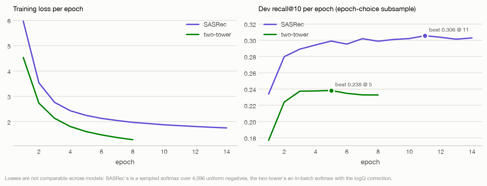
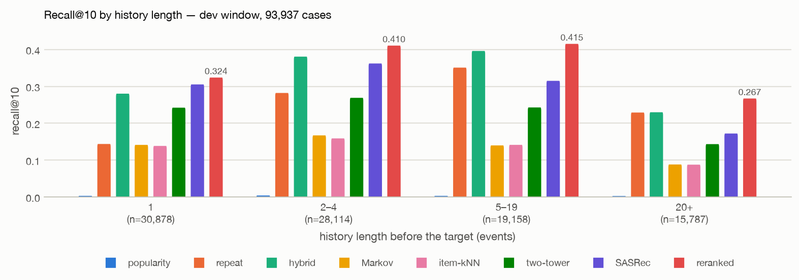
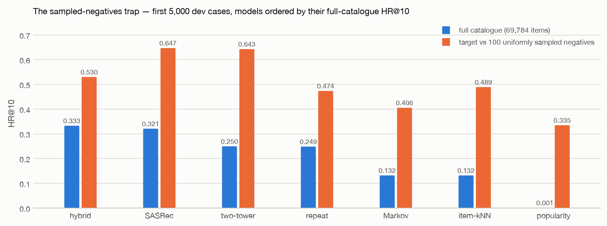
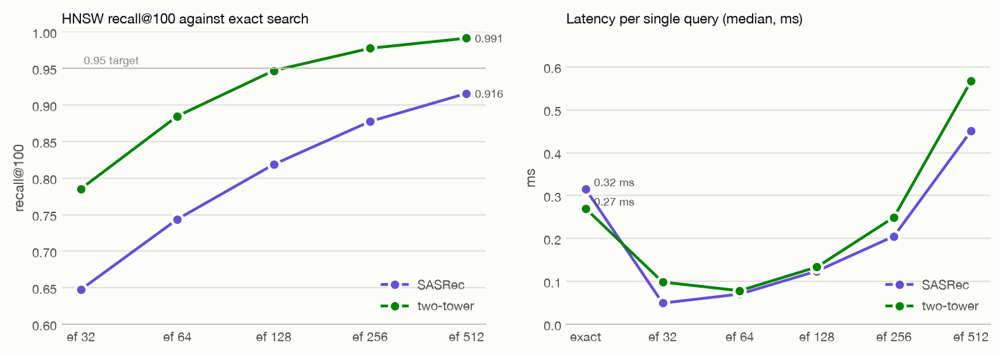
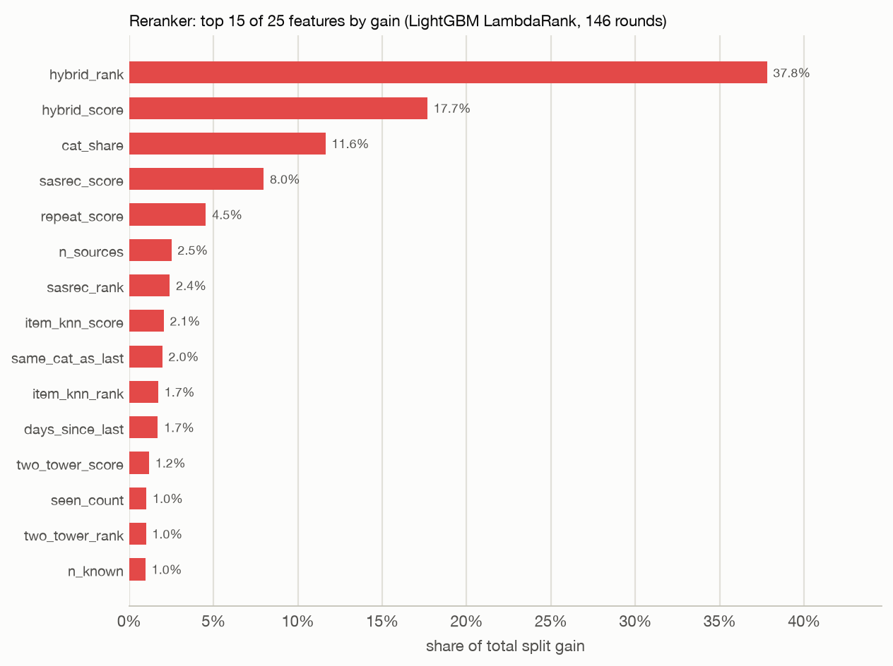
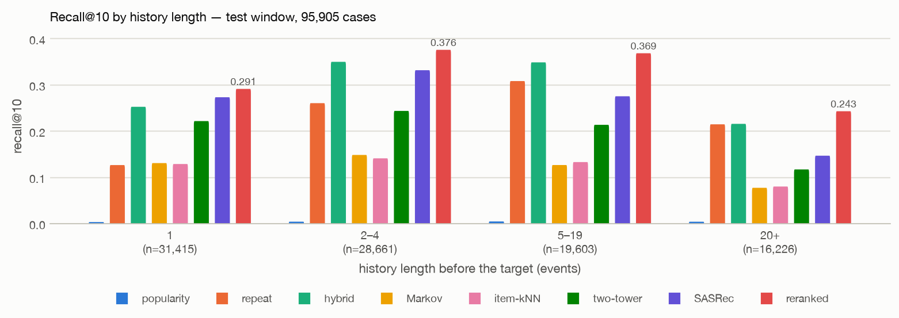
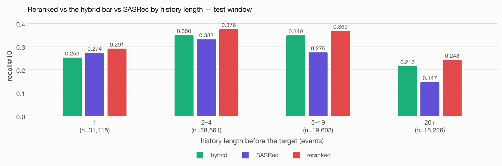
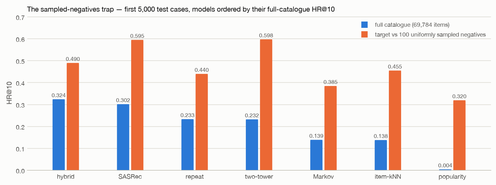

# Design notes

Filled milestone by milestone; each section says what was measured, on which window, and what it changes.

## 1. The data and the split (M1)

Everything here comes from `python scripts/build_dataset.py` (`data/splits/raw_facts.json`, `data/splits/summary.json`).
Build time from the four raw CSVs: 11.8 s, peak resident memory 0.81 GB (macOS, Python 3.11, pandas 3.1); 5.9 s from
the parquet cache. The two property files (20.3M rows, 893 MB) are streamed in 2M-row chunks and only their
`categoryid` rows are kept, latest value per item.

### 1.1 Raw facts against the dataset page

| Quantity | Dataset page | Measured |
|---|---|---|
| Events | ≈ 2.76M: ≈ 2.66M views, ≈ 69k add-to-carts, ≈ 22k transactions | 2,756,101: 2,664,312 views (96.7%), 69,332 add-to-carts (2.5%), 22,457 transactions (0.8%) |
| Visitors / items in events | ≈ 1.41M / ≈ 235k | 1,407,580 / 235,061 |
| Period (UTC) | 2015-05-03 → 2015-09-18 | 2015-05-03 03:00 → 2015-09-18 02:59 (138 days) |
| Category tree | ≈ 1.7k categories | 1,669 rows; 417,053 items carry a `categoryid` (many never appear in events), 1,180 distinct categories among them, 940 among vocabulary items |
| Behaviour | most visitors have a single event; heavy repeat viewing | 76.5% of training-window visitors have one event; 25.5% of dev targets are items the visitor already opened (§1.5) |

### 1.2 Cleaning, sessions, windows

- A view that repeats the previous event's item for the same visitor within 30 minutes (a refresh or a back-click) is
  dropped: 2,756,101 → 2,475,306 events (−10.2%). A later re-visit of the same item is kept; it is a real next-item
  target in e-commerce.
- A gap longer than 30 minutes starts a new session: 1,763,140 sessions over all windows. Markov transitions and
  item-kNN co-occurrence use training-window sessions only.
- Global time split, 14-day windows counted back from the last event (UTC):

| Window | From | To | Events | Visitors | Items | Events whose item is in the vocabulary |
|---|---|---|---|---|---|---|
| train | 2015-05-03 03:00 | 2015-08-07 02:59 (96 days) | 1,809,085 | 1,023,737 | 204,788 | 86.7% |
| rerank | 2015-08-07 02:59 | 2015-08-21 02:59 | 221,590 | 142,514 | 73,312 | 79.7% |
| dev | 2015-08-21 02:59 | 2015-09-04 02:59 | 221,473 | 141,764 | 72,827 | 77.6% |
| test | 2015-09-04 02:59 | 2015-09-18 02:59 | opened once, in M4 | | | |

### 1.3 Vocabulary

Items with at least 5 events before T0: **69,784**, which is 34.1% of the 204,788 items seen in training but 86.7% of
training events. Index = popularity rank (0 = PAD, 1 = UNK). The share of events the vocabulary covers falls to 79.7%
in the rerank window and 77.6% in dev as new products arrive; a target outside the vocabulary is a miss for every
id-based model and is counted, never dropped ("reachable" below). The cold-item path through the category (M3) is
the only way to reach those.

### 1.4 Training sequences

240,351 visitors have at least two training events (23.5% of the 1,023,737 training visitors) and contribute
1,025,699 events (56.7% of the training window). Sequence length: median 2, p95 10, 0.3% longer than the model
history of 50. Single-event visitors still count: their one item feeds popularity, sessions and the item vocabulary.

### 1.5 What a case is, and what the cases look like

A case is one event in the window whose visitor has at least one earlier event anywhere; the history is that
visitor's earlier events (last 50), the target is the event's item. Predictions use only events before that moment,
including earlier events inside the same window. *Warm* = the visitor had an event before the window; a *cold*
visitor was first seen inside it and still has ≥ 1 in-window event as history. *Repeat* = the target is in the
history. Metrics are per case; confidence intervals resample visitors, so a visitor with 40 cases is one cluster.

| | rerank window | dev window |
|---|---|---|
| cases (events with ≥ 1 earlier event) | 92,536 of 221,590 events (41.8%) | 93,937 of 221,473 events (42.4%) |
| visitors behind them | 36,527 | 38,012 |
| history length p25 / p50 / p75 / p90 / p95 / p99 | 1 / 3 / 9 / 62 / 399 / 2,753 | 1 / 3 / 9 / 78 / 520 / 1,808 |
| history buckets 1 / 2–4 / 5–19 / 20+ | 32.1% / 29.6% / 21.6% / 16.8% | 32.9% / 29.9% / 20.4% / 16.8% |
| warm visitors | 38.3% | 39.1% |
| repeat targets | 26.0% | 25.5% |
| reachable targets (in the vocabulary) | 81.9% | 79.2% |
| repeat share among reachable targets | 31.8% | 32.2% |
| target type view / add-to-cart / transaction | 90,032 / 1,778 / 726 | 91,480 / 1,715 / 742 |

Two things shape everything that follows. A third of the cases have a single-item history, so "the last item" is all a
model gets. And the tail is heavy: 1% of cases come from visitors with more than 1,800 earlier events, which look like
crawlers rather than shoppers; truncating the history to 50 and clustering the bootstrap by visitor keeps them from
dominating either the models or the intervals.

## 2. Baselines on dev (M1)

`python scripts/train_baselines.py` (popularity, repeat, Markov, item-kNN fitted on the training window in 15 s) and
`python scripts/evaluate.py --split dev --no-rerank --sampled-demo` (93,937 dev cases from 38,012 visitors, full
catalogue of 69,784 items, 500 visitor-bootstrap resamples; 6.5 min on CPU, peak 1.3 GB). Results:
`eval/results/dev-summary.md` / `.json`. Point estimate [95% CI].

| model | recall@10 | recall@20 | ndcg@10 | mrr@10 | coverage@10 | pop. quantile |
|---|---|---|---|---|---|---|
| repeat | 0.2416 [0.2336, 0.2493] | 0.2481 [0.2404, 0.2556] | 0.1906 [0.1835, 0.1976] | 0.1736 [0.1666, 0.1802] | 0.434 | 0.083 |
| markov | 0.1396 [0.1355, 0.1435] | 0.1653 [0.1607, 0.1698] | 0.0859 [0.0833, 0.0885] | 0.0693 [0.0669, 0.0714] | 0.488 | 0.097 |
| item_knn | 0.1364 [0.1320, 0.1408] | 0.1790 [0.1733, 0.1846] | 0.0782 [0.0758, 0.0807] | 0.0603 [0.0583, 0.0622] | 0.609 | 0.315 |
| popularity | 0.0030 [0.0024, 0.0036] | 0.0072 [0.0063, 0.0082] | 0.0014 [0.0011, 0.0017] | 0.0009 [0.0007, 0.0011] | 0.000 | 0.000 |

Paired visitor-bootstrap differences in recall@10 against the best baseline (repeat); every interval excludes 0:

| comparison | difference [95% CI] |
|---|---|
| markov − repeat | −0.1020 [−0.1090, −0.0945] |
| item_knn − repeat | −0.1052 [−0.1124, −0.0977] |
| popularity − repeat | −0.2386 [−0.2464, −0.2306] |

Recall@10 by subset (point estimates; n = cases):

| subset | n | popularity | repeat | markov | item_knn |
|---|---|---|---|---|---|
| warm visitors | 36,736 | 0.0033 | 0.2300 | 0.0817 | 0.0791 |
| cold visitors | 57,201 | 0.0028 | 0.2490 | 0.1768 | 0.1733 |
| repeat targets | 23,929 | 0.0076 | 0.9448 | 0.1563 | 0.1423 |
| new targets | 70,008 | 0.0015 | 0.0012 | 0.1339 | 0.1345 |
| history 1 | 30,878 | 0.0028 | 0.1436 | 0.1411 | 0.1383 |
| history 2–4 | 28,114 | 0.0038 | 0.2820 | 0.1669 | 0.1587 |
| history 5–19 | 19,158 | 0.0028 | 0.3508 | 0.1397 | 0.1412 |
| history 20+ | 15,787 | 0.0024 | 0.2289 | 0.0880 | 0.0875 |
| target = view | 91,480 | 0.0030 | 0.2380 | 0.1398 | 0.1366 |
| target = add-to-cart | 1,715 | 0.0035 | 0.2315 | 0.1539 | 0.1574 |
| target = transaction | 742 | 0.0054 | 0.7089 | 0.0863 | 0.0741 |

**Repeat wins, and the breakdown says why.** A quarter of the dev targets (25.5%) are items the visitor already
opened, and on those the repeat baseline scores 0.945: 0.255 × 0.945 ≈ 0.241, which is its entire recall. On new
targets it is 0.001 (it can only offer seen items; the popularity prior fills the list), while Markov and item-kNN
reach 0.134. The sequential baselines barely see the repeat signal (0.156 and 0.142 on repeat targets): session
transitions rarely point back to the same item once refreshes are removed, and training sequences are short (median
2). The business slice is the clearest case: repeat finds 70.9% of purchases in the top 10 (so at least that share of
purchases is of an item already in the history) and Markov 8.6%. With a single-item history the three non-trivial baselines tie at ≈ 0.14:
the one item is both the repeat candidate and the Markov context. Heavy visitors (20+ events) are hardest for
everyone, Markov and item-kNN dropping to 0.09; many of them are the crawler-like tail of §1.5.

**Popularity is not a bar here.** With 69,784 vocabulary items and a flat head, the ten most viewed products are
the next item 0.3% of the time (coverage@10 is those ten items; popularity quantile 0.000). "Beats popularity" means
nothing on this catalogue; the bars that matter are repeat (0.242) and the sequential pair (≈ 0.14).

**Markov vs item-kNN.** Markov is ahead at @10 (0.140 vs 0.136, a gap inside the intervals) and item-kNN at @20
(0.179 vs 0.165); item-kNN recommends from a wider and less popular slice of the catalogue (coverage 0.609 vs 0.488,
popularity quantile 0.315 vs 0.097), which is what the reranker will later be able to exploit.

**What this sets up.** Repeat and the sequential baselines are complementary: repeat covers 25.5% of cases at 0.945,
the sequential models cover the other 74.5% at 0.134, so a perfect choice between them would reach ≈ 0.34 recall@10.
That is the room for SASRec and the two-tower model (M2), which score seen and unseen items in one list, and for the
reranker (M3), whose `seen_count` and `last_seen_pos` features encode exactly this split.

**The sampled-negatives trap, first look.** On the first 5,000 dev cases, HR@10 against 100 uniformly sampled
negatives (the protocol of many papers) next to the full-catalogue HR@10 on the same cases:

| model | full-catalogue HR@10 | HR@10 vs 100 sampled negatives |
|---|---|---|
| item_knn | 0.132 | 0.489 |
| repeat | 0.249 | 0.474 |
| markov | 0.132 | 0.406 |
| popularity | 0.001 | 0.335 |

Sampling reorders the models (item-kNN overtakes repeat) and inflates popularity 280×, because a target only has to
beat 100 random tail items instead of 69,784. §3 repeats the demonstration with the learned models.

## 3. SASRec and the two-tower model (M2)

Both models are written from scratch in PyTorch (`recsys/sasrec.py`, `recsys/two_tower.py`) and trained on the
240,351 training-window sequences with at least two events. The epoch is chosen by early stopping (patience 3) on
recall@10 over a fixed 20,000-case dev subsample (`ds.cases("dev", max_cases=20000, seed=1)`); every run in this
section is scored on that same subsample, and the choice between runs was made once, by `scripts/choose_config.py`,
before the full dev evaluation in §3.5. Training logs: `eval/results/train_sasrec.json`,
`eval/results/train_two_tower.json`; the choices: `eval/results/sasrec_choice.json`, `eval/results/two_tower_choice.json`.

The bar is no longer popularity but the **hybrid** baseline added in this milestone (`recsys/baselines.py: Hybrid`):
repeat first (the shopper's own items, most recent first), then the Markov continuation of the last items, then
popularity. It is the union of the two complementary signals of §2 in one deterministic list.

### 3.1 One epoch on CPU and on Apple MPS

SASRec at the default configuration (dim 64, 2 layers, 2 heads, max_len 50, 1,024 negatives, batch 128), one epoch
plus the dev check on 2,000 cases, measured with `/usr/bin/time -l`:

| device | seconds per epoch | peak RSS | loss after the epoch | dev recall@10 (2k cases) |
|---|---|---|---|---|
| cpu (4 OpenMP threads) | 115.2 | 1.09 GB | 4.7191 | 0.2365 |
| mps | 60.3 | 1.06 GB | 4.7191 | 0.2365 |

Same numbers to four decimals on both devices; MPS is 1.9× faster, so everything below trains on MPS. Neither comes
near the 15-minute threshold that would have called for a smaller max_len or fewer negatives.

### 3.2 SASRec: the default run and three single-axis changes

| run | change | best epoch / epochs run | dev recall@10 (20k) | s / epoch | total s |
|---|---|---|---|---|---|
| default | — | 12 / 15 | 0.2982 | 58.4 | 879 |
| max_len 20 | max_len 50 → 20 | 20 / 20 | 0.2974 | 47.4 | 949 |
| negatives 256 | 1,024 → 256 | 14 / 17 | 0.2809 | 51.7 | 881 |
| **negatives 4,096 (chosen)** | 1,024 → 4,096 | 11 / 14 | **0.3056** | 57.7 | 810 |
| event weights | view / add-to-cart / transaction targets weighted 1 / 3 / 5 | 13 / 16 | 0.2964 | 54.4 | 872 |

- **Negatives are the one axis that matters.** 256 → 1,024 → 4,096 gives 0.281 → 0.298 → 0.306, monotone, at no
  cost in time: the negatives are shared by the whole batch, so 4,096 of them is one extra (positions × 4,096)
  matrix product. Uniform negatives are mostly tail items that are easy to rank below the target; more of them
  make the sampled softmax a closer approximation of the full one, which is what the model is scored on.
- **max_len 20 vs 50: no difference** (0.297 vs 0.298; the shorter run was still creeping up at epoch 20). The
  median history has 3 events and 83% of cases have fewer than 20, so the extra positions are rarely used; the
  17% with 20 or more are the heavy tail where every model is weak anyway (§2). The default 50 is kept because it
  costs 11 s per epoch and nothing in quality.
- **Event-weighted training does not help the all-events metric** (0.296 vs 0.298). 97.4% of targets are views, so
  tripling the weight of 1.8% add-to-carts and quintupling 0.8% purchases barely moves the gradient; whether it
  helps a purchase-only metric is a question for M6. The option stays (`SASRecConfig.event_weights`, off by
  default; `--event-weights 1,3,5`).
- The curves (§3.4) show why patience 3 is enough: dev recall is within 0.01 of its best from epoch 5 on while the
  loss keeps falling; dropout 0.2 and the tied output embeddings keep the model from overfitting the 240k short
  sequences.

### 3.3 Two-tower: default and without the logQ correction

634,653 (history, next item) training examples from the same sequences (every prediction point of the last 50
positions, next item inside the vocabulary), batch 1,024, temperature 0.05, L2-normalised towers.

| run | change | best epoch / epochs run | dev recall@10 (20k) | s / epoch | total s |
|---|---|---|---|---|---|
| **default (chosen)** | — | 5 / 8 | **0.2383** | 24.1 | 195 |
| no logQ | logQ correction off | 5 / 8 | 0.2021 | 23.9 | 193 |

The logQ correction is worth +0.036 recall@10, the largest single effect in this milestone (§3.8 says why). The
two-tower peaks at epoch 5 and then overfits: its loss keeps falling while dev recall drops, which is what a model
with a single dot product and no sequence structure does once the item embeddings memorise the training pairs.

### 3.4 Training curves



Loss per epoch and dev recall@10 per epoch for the chosen runs (SASRec with 4,096 negatives, two-tower default);
the marker is the epoch whose weights were kept. The loss scales are not comparable across the two models.

### 3.5 Every model on the full dev window

`python scripts/evaluate.py --split dev --no-rerank --sampled-demo`: 93,937 cases from 38,012 visitors, full
catalogue of 69,784 items, 500 visitor-bootstrap resamples (9.9 min on CPU, peak 1.96 GB). Point [95% CI].

| model | recall@10 | recall@20 | ndcg@10 | mrr@10 | coverage@10 | pop. quantile |
|---|---|---|---|---|---|---|
| hybrid | 0.3254 [0.3149, 0.3347] | 0.3520 [0.3407, 0.3619] | 0.2279 [0.2199, 0.2355] | 0.1965 [0.1890, 0.2035] | 0.602 | 0.141 |
| sasrec | 0.3018 [0.2912, 0.3115] | 0.3521 [0.3410, 0.3626] | 0.2050 [0.1971, 0.2128] | 0.1748 [0.1676, 0.1816] | 0.740 | 0.222 |
| repeat | 0.2416 [0.2336, 0.2493] | 0.2481 [0.2404, 0.2556] | 0.1906 [0.1835, 0.1976] | 0.1736 [0.1666, 0.1802] | 0.434 | 0.083 |
| two_tower | 0.2336 [0.2255, 0.2416] | 0.2816 [0.2720, 0.2907] | 0.1514 [0.1458, 0.1573] | 0.1259 [0.1210, 0.1312] | 0.751 | 0.211 |
| markov | 0.1396 [0.1355, 0.1435] | 0.1653 [0.1607, 0.1698] | 0.0859 [0.0833, 0.0885] | 0.0693 [0.0669, 0.0714] | 0.488 | 0.097 |
| item_knn | 0.1364 [0.1320, 0.1408] | 0.1790 [0.1733, 0.1846] | 0.0782 [0.0758, 0.0807] | 0.0603 [0.0583, 0.0622] | 0.609 | 0.315 |
| popularity | 0.0030 [0.0024, 0.0036] | 0.0072 [0.0063, 0.0082] | 0.0014 [0.0011, 0.0017] | 0.0009 [0.0007, 0.0011] | 0.000 | 0.000 |

Paired visitor-bootstrap differences in recall@10 against the best baseline, which is now the hybrid:

| comparison | difference [95% CI] | |
|---|---|---|
| sasrec − hybrid | −0.0235 [−0.0271, −0.0196] | SASRec does not beat the hybrid |
| two_tower − hybrid | −0.0918 [−0.0960, −0.0870] | the two-tower does not beat the hybrid, nor repeat alone |
| repeat − hybrid | −0.0838 [−0.0870, −0.0800] | |
| markov − hybrid | −0.1857 [−0.1937, −0.1764] | |
| item_knn − hybrid | −0.1889 [−0.1975, −0.1798] | |
| popularity − hybrid | −0.3223 [−0.3318, −0.3119] | |

**The plain answer.** Neither learned model beats the hybrid on dev recall@10; both intervals exclude zero on the
wrong side. SASRec is 0.024 below it (and ties it at recall@20: 0.3521 vs 0.3520, with much wider coverage, 0.74 vs
0.60); the two-tower is 0.092 below it and 0.008 below plain repeat. Compared with the bar that most papers use,
every learned model beats popularity a hundredfold, which says nothing. Compared with the hybrid, the honest line is
that a two-layer SASRec with the right loss recovers 93% of a deterministic rule's recall in a single list and wins
where the rule cannot look: new targets and one-event histories. The breakdown says exactly where.

### 3.6 Where each model wins and loses

Recall@10 by subset (n = cases):

| subset | n | popularity | repeat | hybrid | markov | item_knn | two_tower | sasrec |
|---|---|---|---|---|---|---|---|---|
| warm visitors | 36,736 | 0.0033 | 0.2300 | 0.2577 | 0.0817 | 0.0791 | 0.1798 | 0.2226 |
| cold visitors | 57,201 | 0.0028 | 0.2490 | 0.3688 | 0.1768 | 0.1733 | 0.2681 | 0.3527 |
| repeat targets | 23,929 | 0.0076 | 0.9448 | 0.9449 | 0.1563 | 0.1423 | 0.5536 | 0.7661 |
| new targets | 70,008 | 0.0015 | 0.0012 | 0.1136 | 0.1339 | 0.1345 | 0.1242 | **0.1431** |
| history 1 | 30,878 | 0.0028 | 0.1436 | 0.2801 | 0.1411 | 0.1383 | 0.2421 | **0.3052** |
| history 2–4 | 28,114 | 0.0038 | 0.2820 | 0.3806 | 0.1669 | 0.1587 | 0.2688 | 0.3620 |
| history 5–19 | 19,158 | 0.0028 | 0.3508 | 0.3960 | 0.1397 | 0.1412 | 0.2427 | 0.3149 |
| history 20+ | 15,787 | 0.0024 | 0.2289 | 0.2297 | 0.0880 | 0.0875 | 0.1432 | 0.1720 |
| target = view | 91,480 | 0.0030 | 0.2380 | 0.3224 | 0.1398 | 0.1366 | 0.2348 | 0.3032 |
| target = add-to-cart | 1,715 | 0.0035 | 0.2315 | 0.3149 | 0.1539 | 0.1574 | 0.1971 | 0.2554 |
| target = transaction | 742 | 0.0054 | 0.7089 | 0.7143 | 0.0863 | 0.0741 | 0.1698 | 0.2372 |



**New targets vs repeat targets is the whole story.** On the 74.5% of cases whose target the visitor has never
opened, SASRec is the best model there is: 0.143 against 0.134 for Markov, 0.135 for item-kNN and 0.114 for the
hybrid, whose top slots are taken by seen items that are, by definition, wrong on these cases. On the 25.5% of
repeat targets SASRec finds the item 76.6% of the time, which is five times Markov and the proof that a sequence
model learns re-visits from data, but the hybrid's lookup finds it 94.5% of the time. The arithmetic of the paired
difference is just these two rows: 0.255 × (0.766 − 0.945) = −0.046 lost on repeats, 0.745 × (0.143 − 0.114) =
+0.022 won on new targets, net −0.024. The same split explains the history buckets (SASRec wins only with a
single-event history, where there is nothing to repeat but the one item it also ranks first), the warm/cold rows
(warm visitors have longer, repeat-heavier histories) and the business line: 71% of purchases are repeats, so the
hybrid finds 0.714 of transactions and SASRec 0.237. The two-tower is weaker on both halves (0.554 on repeats,
0.124 on new targets, below Markov); it earns its place in M3 as the retrieval model with a category path for new
items, not as a ranker.

### 3.7 The sampled-negatives demonstration

The same 5,000 dev cases (the first 5,000), each model's HR@10 against the full catalogue next to its HR@10 when
the target only competes with 100 uniformly sampled negatives, the protocol of many papers:

| model | full-catalogue HR@10 | HR@10 vs 100 sampled negatives |
|---|---|---|
| hybrid | 0.333 | 0.530 |
| sasrec | 0.321 | 0.647 |
| two_tower | 0.250 | 0.643 |
| repeat | 0.249 | 0.474 |
| markov | 0.132 | 0.406 |
| item_knn | 0.132 | 0.489 |
| popularity | 0.001 | 0.335 |



Sampling reorders the models. Under the full catalogue the hybrid leads SASRec by 0.012 and the two-tower trails
SASRec by 0.071; with 100 sampled negatives SASRec "beats" the hybrid by 0.117 and the two-tower ties SASRec
(0.643 vs 0.647). Item-kNN overtakes repeat, Markov drops below both, and popularity climbs from 0.001 to 0.335.
The mechanism (Krichene & Rendle, KDD 2020): a sampled metric only asks whether the target beats 100 mostly
obscure items, which rewards models that spread probability smoothly over the catalogue (the embedding models,
item-kNN) and punishes models that put everything on a few items and nothing elsewhere (repeat, the hybrid), while
the shopper sees ten items out of 69,784, which is what the full ranking measures. Every number in this project
is the full ranking; this table is the reason.

### 3.8 Why these two losses

**SASRec: a sampled softmax with uniform negatives.** The model predicts the next item at every one of the 50
positions, so a full softmax costs batch × positions × catalogue logits: 128 × 50 × 69,784 ≈ 450M floats, 1.8 GB
per step, for a gradient that is dominated by the 69,000 items that were never going to be ranked near the target.
The sampled softmax keeps the target and N uniformly drawn negatives, shared by the whole batch, and applies
cross-entropy to that short list. Uniform sampling is the one proposal that needs no correction term: the sampled
softmax subtracts log Q(j) from every candidate's logit, and with Q uniform that is the same constant for every
item, which cancels in the softmax. It is also why the ablation goes the way it does: uniform negatives are mostly
easy, and the approximation improves with their number, so 4,096 beats 1,024 beats 256 at essentially no cost (the
negatives are shared, so the extra work is one matrix product). An accidental hit (a negative equal to the target)
is masked out. The original SASRec paper used a binary cross-entropy with one negative per position; cross-entropy
over many negatives is the change that Klenitskiy & Vasilev (RecSys 2023) showed closes most of the gap to
BERT4Rec, and it is the loss here.

**Two-tower: in-batch negatives with the logQ correction.** The two-tower model exists to be served through a
nearest-neighbour index, so its score must be a dot product between a user vector and an item vector, and it is
trained the way it is served: the other 1,023 positives in the batch are the negatives, which are free and, because
positives are drawn in proportion to how often items are bought and viewed, they are hard negatives that look like
real candidates. That proportionality is also the bias: a popular item appears as a negative far more often than a
rare one and gets pushed down accordingly, so the softmax that the loss optimises is conditional on the batch's
sampling distribution, not on the shopper. The correction of Yi et al. (RecSys 2019) subtracts log q(item), the
item's sampling probability, from each logit, which restores the softmax over the true distribution in expectation.
On this catalogue, where the hits sit in the popular head (§2), training without it costs 0.036 recall@10, more
than any architecture knob. The item tower reads the item id, its category and its parent category, which is what
makes the cold-start path of M3 possible: an item outside the vocabulary still gets a vector from its category.

### 3.9 What the models learned about repeats

Nothing in either model says "recommend what the shopper already saw", yet SASRec finds the repeat target 76.6% of
the time and the two-tower 55.4%. Both learned it from the sequences: consecutive refreshes were removed in §1.2,
but a later re-visit stays, so a quarter of the training targets are items that already occur earlier in the same
sequence. With tied output embeddings, SASRec can score an item in its own context highly by making the hidden
state at position i point towards the embedding of an item it attended to, and the attention weights make that easy
for the last few items; the two-tower gets most of the way with the last item's embedding, which its user tower
concatenates explicitly, and dilutes older ones in the mean pool. What neither learns is the rule's reliability: a
lookup is right 94.5% of the time regardless of how long ago the item was seen, while a softmax over dot products
has to trade that probability mass against the new-target candidates it is also better at. That trade is the
reason the hybrid wins the single-list comparison, and the reason the reranker of M3 exists: its `seen_count` and
`last_seen_pos` features restore the lookup, and SASRec's candidates supply what the lookup cannot see. The ceiling
that the two rows of §3.6 allow, 0.255 × 0.945 + 0.745 × 0.143 ≈ 0.35 recall@10, is the number to compare M3 to.

### 3.10 Reproduce

```bash
python scripts/train_baselines.py --models hybrid
python scripts/train_neural.py --model sasrec --device mps --negatives 4096        # the chosen configuration
python scripts/train_neural.py --model two_tower --device mps
python scripts/evaluate.py --split dev --no-rerank --sampled-demo
python scripts/plots.py
```
The ablations are the same commands with `--max-len 20`, `--negatives 256`, `--event-weights 1,3,5`, `--no-logq`
and `--tag <name> --out eval/results/ablations`; `scripts/choose_config.py --model sasrec|two_tower` makes the choice.

## 4. Retrieval and reranking (M3)

Stage one retrieves candidates from every source; stage two reranks their union with a LightGBM LambdaRank model.
This section measures the index that serves the embedding models (§4.1), how the reranker is trained and what it
learned (§4.2–4.3), what it does on dev against the hybrid bar (§4.4), the two cold-start paths (§4.5) and what
each piece costs at inference (§4.6). Files: `eval/results/ann_*.json`, `train_reranker.json`, `rerank_choice.json`,
`dev-summary.md`, `cold_items-dev.json`, `source_cost.json`.

### 4.1 Exact search vs HNSW over the item vectors

`python scripts/build_index.py --model sasrec|two_tower --ef 32,64,128,256,512`: 69,784 item vectors of dimension 64,
5,000 dev user vectors as queries, k = 100; recall@100 of HNSW (M = 32, efConstruction 200) against the exact
inner-product search, latency per query batched (5,000 at once) and single (median of 200 one-at-a-time queries).
CPU, 4 threads. `eval/results/ann_sasrec.json`, `ann_two_tower.json`.

| index | SASRec recall@100 | SASRec batched / single ms | two-tower recall@100 | two-tower batched / single ms |
|---|---|---|---|---|
| exact (IndexFlatIP) | 1 | 0.033 / 0.315 | 1 | 0.032 / 0.270 |
| HNSW ef 32 | 0.648 | 0.012 / 0.049 | 0.785 | 0.014 / 0.098 |
| HNSW ef 64 | 0.744 | 0.024 / 0.070 | 0.885 | 0.023 / 0.078 |
| HNSW ef 128 | 0.819 | 0.035 / 0.124 | 0.947 | 0.043 / 0.133 |
| HNSW ef 256 | 0.878 | 0.063 / 0.205 | **0.978** | 0.075 / 0.249 |
| HNSW ef 512 | 0.916 | 0.115 / 0.450 | 0.991 | 0.165 / 0.567 |



**The served index is exact search, for both models.** At 70k items × 64 dimensions a brute-force inner product
costs 0.3 ms per single query and 0.03 ms per query in a batch, which is below anything else in the request
(§4.6). HNSW is only faster where it is wrong: the two-tower reaches the 0.95 recall target at ef 256, and there
a single query costs 0.25 ms, the same as exact, while a batch costs 2.3× more; SASRec never reaches the target,
0.916 at ef 512 and 0.45 ms, slower than exact. SASRec's vectors are the reason for the gap between the two models:
their norms run from 0.64 to 1.89 (popular items are long), and HNSW's graph search over a maximum inner product
is not a metric search, so it misses high-norm neighbours that exact search finds. The textbook repair, one extra
coordinate that gives every vector the same length (Bachrach et al., 2014), was tried and changed nothing (0.809
vs 0.819 at ef 128), which is consistent with the literature on graph indexes for inner product (Morozov & Babenko,
2018). HNSW earns its place at a catalogue ten to a hundred times larger; here the honest table says to skip it,
and the saved `index_*_hnsw.faiss` files exist only so M5 can show both paths.


### 4.2 Training the reranker on its own window

`python scripts/train_reranker.py`: 40,000 cases sampled from the rerank window [T0, T1), all seven sources,
candidates = the union of every source's top-K. Every candidate carries every source's **dense** score (the user ·
item dot product for SASRec and the two-tower, a gather from the full score vector for the rest), the rank at which
each source proposed it (NaN when it did not) and the number of proposers, plus item statistics from the training
window (log count, log recent count, days since first / last seen), user–item signals (times seen, position of the
last sighting, share of the history in the candidate's category, same category as the last item) and the history
length. 10% of the cases are held out *by case*; LightGBM early-stops on their ndcg@10 over the full candidate lists
and the reranked top-10 is then scored on all of them, misses included: that number, not dev, chose the candidate
budget.

| run | K per source | union recall, all 40k cases (the ceiling) | training rows | best iteration | early-stopping ndcg@10 | held-out union recall | held-out reranked recall@10 | held-out ndcg@10 |
|---|---|---|---|---|---|---|---|---|
| 50 per source | 50 | 0.513 | 363,313 | 214 | 0.5327 | 0.524 | 0.3928 | 0.2794 |
| 20 per source **(chosen)** | 20 | 0.461 | 334,031 | 146 | 0.5943 | 0.472 | 0.3936 | 0.2805 |
| 100 per source | 100 | 0.546 | 378,074 | 185 | 0.4985 | 0.559 | 0.3903 | 0.2786 |

The three budgets are a statistical tie on the ~4,000 held-out cases (standard error ≈ 0.008): the reranker
converts a larger union (0.47 → 0.56 ceiling) into exactly the same top-10, because the extra candidates are deep
tail items it has learned to ignore. The rule fixed in advance (highest held-out recall@10, default keeps ties
within 0.0005) picked K = 20 by 0.0008; it is also the cheapest at inference, so it is the served model. Training
takes about a minute per run on CPU.

**Why a separate window.** The retrievers are fitted on events before T0. Had the reranker been trained on those
same events, its features would have been the retrievers' scores on their *own training data*: Markov's transition
probabilities would be "right" far more often than they are on new traffic, SASRec's logits would be the
memorised sequences, and the reranker would learn to trust them exactly where they will not deserve it. The
rerank window [T0, T1) is the first fortnight the retrievers have never seen, so every feature the reranker sees in
training has the same relationship to the truth that it will have in production. The price is two weeks of
events that the retrievers do not learn from; the alternative, a k-fold scheme over the training window, would cost
k retriever fits per model for a 14-day gain in data.

### 4.3 What the reranker learned

Top 12 of 25 features by split gain (`eval/results/train_reranker.json`, the served K = 20 model):

| # | feature | share of gain |
|---|---|---|
| 1 | `hybrid_rank` | 37.8% |
| 2 | `hybrid_score` | 17.7% |
| 3 | `cat_share` | 11.6% |
| 4 | `sasrec_score` | 8.0% |
| 5 | `repeat_score` | 4.5% |
| 6 | `n_sources` | 2.5% |
| 7 | `sasrec_rank` | 2.4% |
| 8 | `item_knn_score` | 2.1% |
| 9 | `same_cat_as_last` | 2.0% |
| 10 | `item_knn_rank` | 1.7% |
| 11 | `days_since_last` | 1.7% |
| 12 | `two_tower_score` | 1.2% |



The hybrid's rank and score dominate: the reranker starts from the lookup-then-Markov order of §3 and spends
its remaining capacity on the signals the hybrid lacks, SASRec's score and rank, the category share of the
history, item-kNN's vote and the item's recency. The embedding scores are dense here, so SASRec's opinion of a
candidate that only repeat proposed, and repeat's opinion of a SASRec candidate (seen or never seen), are both on
the table; `n_sources`, how many retrievers agree, is the cheap consensus feature.

### 4.4 Dev: the reranked pipeline against the hybrid bar

`python scripts/evaluate.py --split dev --sampled-demo` with all seven sources and the reranker (K = 20 per source):
93,937 cases, 38,012 visitors, 500 visitor-bootstrap resamples; 16.3 min on CPU, peak 1.9 GB. Point [95% CI].

| model | recall@10 | recall@20 | ndcg@10 | mrr@10 | coverage@10 | pop. quantile |
|---|---|---|---|---|---|---|
| **reranked** | **0.3588 [0.3491, 0.3675]** | 0.4069 [0.3969, 0.4163] | 0.2596 [0.2515, 0.2670] | 0.2285 [0.2210, 0.2354] | 0.714 | 0.191 |
| hybrid | 0.3254 [0.3149, 0.3347] | 0.3520 [0.3407, 0.3619] | 0.2279 [0.2199, 0.2355] | 0.1965 [0.1890, 0.2035] | 0.602 | 0.141 |
| sasrec | 0.3018 [0.2912, 0.3115] | 0.3521 [0.3410, 0.3626] | 0.2050 [0.1971, 0.2128] | 0.1748 [0.1676, 0.1816] | 0.740 | 0.222 |
| repeat | 0.2416 [0.2336, 0.2493] | 0.2481 [0.2404, 0.2556] | 0.1906 [0.1835, 0.1976] | 0.1736 [0.1666, 0.1802] | 0.434 | 0.083 |
| two_tower | 0.2336 [0.2255, 0.2416] | 0.2816 [0.2720, 0.2907] | 0.1514 [0.1458, 0.1573] | 0.1259 [0.1210, 0.1312] | 0.751 | 0.211 |
| markov | 0.1396 [0.1355, 0.1435] | 0.1653 [0.1607, 0.1698] | 0.0859 [0.0833, 0.0885] | 0.0693 [0.0669, 0.0714] | 0.488 | 0.097 |
| item_knn | 0.1364 [0.1320, 0.1408] | 0.1790 [0.1733, 0.1846] | 0.0782 [0.0758, 0.0807] | 0.0603 [0.0583, 0.0622] | 0.609 | 0.315 |
| popularity | 0.0030 [0.0024, 0.0036] | 0.0072 [0.0063, 0.0082] | 0.0014 [0.0011, 0.0017] | 0.0009 [0.0007, 0.0011] | 0.000 | 0.000 |

Candidate-union recall on dev, the reranker's ceiling: 0.4405 at the served K = 20 (0.489 at K = 50). The
reranker turns 81% of its ceiling into a top-10 hit.

| paired difference, recall@10 | [95% CI] |
|---|---|
| reranked − hybrid | **+0.0335 [+0.0316, +0.0359]** |
| reranked − sasrec | +0.0570 [+0.0540, +0.0604] |
| reranked − two_tower | +0.1253 [+0.1215, +0.1292] |

**The plain answer: the reranker beats the hybrid**, by 0.034 recall@10 with a paired interval that excludes zero
by a wide margin, and it beats every single model on every metric. Nothing was tuned on dev: the candidate budget
was chosen on the rerank window's held-out cases (§4.2) and this is the first and only dev run of the served model.

Recall@10 by subset (the four unchanged baselines are in §2 and §3.6):

| subset | n | repeat | hybrid | sasrec | two_tower | **reranked** |
|---|---|---|---|---|---|---|
| warm visitors | 36,736 | 0.230 | 0.258 | 0.223 | 0.180 | **0.281** |
| cold visitors | 57,201 | 0.249 | 0.369 | 0.353 | 0.268 | **0.409** |
| repeat targets | 23,929 | **0.945** | **0.945** | 0.766 | 0.554 | 0.940 |
| new targets | 70,008 | 0.001 | 0.114 | 0.143 | 0.124 | **0.160** |
| history 1 | 30,878 | 0.144 | 0.280 | 0.305 | 0.242 | **0.324** |
| history 2–4 | 28,114 | 0.282 | 0.381 | 0.362 | 0.269 | **0.411** |
| history 5–19 | 19,158 | 0.351 | 0.396 | 0.315 | 0.243 | **0.415** |
| history 20+ | 15,787 | 0.229 | 0.230 | 0.172 | 0.143 | **0.267** |
| target = view | 91,480 | 0.238 | 0.322 | 0.303 | 0.235 | **0.357** |
| target = add-to-cart | 1,715 | 0.232 | 0.314 | 0.255 | 0.197 | **0.356** |
| target = transaction | 742 | 0.709 | **0.714** | 0.237 | 0.170 | 0.656 |


**Where the gain comes from.** New targets, entirely: 0.745 × (0.160 − 0.114) = +0.035, against a loss of
0.255 × (0.940 − 0.945) = −0.001 on repeat targets. The reranker keeps the lookup (its `hybrid_rank`,
`repeat_score`, `seen_count` features reproduce 94% of the repeat recall) and, on the three quarters of cases
whose target is new, ranks SASRec's candidates with item-kNN's vote, the Markov transition and the category share
of the history on top of SASRec's own score, which lifts new-target recall above SASRec alone (0.160 vs 0.143). It
wins every history bucket, including the single-event histories where SASRec was the only model ahead of the
hybrid, and both cold and warm visitors. The one place it gives something back is purchases: 0.656 against the
hybrid's 0.714 on 742 transaction targets, because LambdaRank weights every event type the same and the model
spends a few of the ten slots on new candidates where a purchase is almost always a repeat (§2). An objective or
a candidate rule that treats a shopper with items in the cart differently is the obvious M6 item.

**What the reranker fixed, and what it cannot.** It fixed the single-list trade-off of §3.9: a lookup and a
sequence model no longer compete for the same ten slots, and the result lands at 0.359, above the ≈ 0.35
arithmetic ceiling estimated there, because new-target recall rose beyond SASRec's own. What it cannot fix is a
target that no source proposes. Of the dev cases, 20.8% have a target outside the vocabulary, which every id-based
retriever scores at zero and which the category-only item path cannot rescue (§4.5); and among the reachable
targets the seven retrievers together put the right item in their top-20 lists for only 44% of all
cases. The reranker's recall is bounded by that union, and the rest of the gap between 0.359 and the ceiling is
ranking among 69 candidates. Raising the ceiling is retrieval work (better candidates, content signals), not
reranking work: K = 100 lifted the ceiling from 0.47 to 0.56 on the rerank window and the reranked top-10 did not
move, because the extra candidates were tail items.

### 4.5 Cold start

**Cold visitors.** A visitor with a single click (33% of cases) is best served by the reranked list (0.324), then
SASRec alone (0.305); both beat the hybrid (0.280), whose only non-trivial signal on one click is the Markov
successor list (0.141). A visitor first seen inside the window (61% of cases) gets 0.409 from the reranked list
against 0.369 from the hybrid. With zero clicks nothing but popularity is available, and popularity is the next
item 0.3% of the time on this catalogue; the API therefore requires at least one item and the product shows the
popular list only as a fallback.

**New items.** `python scripts/cold_items.py`: the two-tower item tower is applied to every catalogue item with a
known category that is outside the vocabulary (UNK id + category + parent, `embed_new_items`), 355,310 items on
top of the 69,784, with no training and no change to any other model.

| | two-tower, vocabulary only | two-tower + catalogue |
|---|---|---|
| dev targets reachable | 79.2% | **97.7%** (+17,376 cases, 18.5%) |
| recall@10, all dev cases | 0.2336 | 0.2315 |
| recall@10 on the newly reachable targets | 0 (unreachable) | **0.0006** |
| recall@10 on vocabulary targets | 0.2949 | 0.2922 |

The honest cold-start number is 0.0006. The category path makes the targets *reachable*, not *findable*: the
355,310 new items share 996 distinct category/parent vectors, so a category holds on average 357 items with
exactly the same vector, and a top-10 can carry ten of them. Even when the tower picks the right category the
chance of showing the right new item is about 10 in 357, and the flood of identical vectors costs the vocabulary
targets 0.003. On this dataset new items have no other content (the property values are hashed), so the next step
for new-item cold start is a content signal, not a better tower; the M3 result is the floor against which such a
signal would be measured.

### 4.6 What each piece costs at inference

`python scripts/bench_sources.py`: 10,000 dev cases, top-50 per source, in chunks of 1,000, CPU with 4 OpenMP
threads, plus 200 single-shopper requests through the whole path (`eval/results/source_cost.json`).

| source | ms per 1,000 cases (top-50) | single request p50 / p90 (ms) |
|---|---|---|
| popularity | 1,024 | 1.10 / 1.23 |
| repeat | 984 | 1.07 / 1.19 |
| hybrid | 1,006 | 1.24 / 1.39 |
| markov | 978 | 1.13 / 1.22 |
| item_knn | 588 | 0.57 / 1.14 |
| two_tower | 634 | 1.15 / 1.40 |
| sasrec | 143 | 1.22 / 1.47 |
| reranker: features (69 candidates per case) | 484 | 2.58 / 2.97 (features + predict) |
| reranker: LightGBM predict | 144 | |
| **whole request** (7 sources + features + predict) | | **10.1 / 11.5** |

Two things to carry into M5. The "cheap" baselines are the slow ones per case, because `score_batch` materialises
a dense 69,784-wide score row and `topk` sorts it: a request through all seven sources costs about 10 ms here, of
which 7 ms is seven dense top-k passes that the serving layer can replace with sparse lookups (repeat and Markov
touch a few dozen items each) or drop (popularity and the hybrid add nothing the reranker does not already get from
repeat and Markov). And the reranker itself is 2.6 ms per request, so the 50 ms budget on a slower CPU is not
threatened by the ranking stage.

### 4.7 Reproduce

```bash
python scripts/build_index.py --model sasrec --ef 32,64,128,256,512 && python scripts/build_index.py --model two_tower --ef 32,64,128,256,512
python scripts/train_reranker.py                                   # K = 50, writes train_reranker.json
python scripts/train_reranker.py --per-source 20 --tag k20 --out eval/results/ablations
python scripts/train_reranker.py --per-source 100 --tag k100 --out eval/results/ablations
python scripts/choose_config.py --model reranker                   # held-out choice → models/reranker.joblib
python scripts/evaluate.py --split dev --sampled-demo
python scripts/cold_items.py && python scripts/bench_sources.py && python scripts/plots.py
```

## 5. Test results (M4) — run once on 2026-10-28

`python scripts/evaluate.py --split test --final --sampled-demo`, executed once, with every model frozen as chosen on
dev or the rerank window: the five baselines fitted on events before T0, SASRec with 4,096 negatives (best epoch 11),
the two-tower with logQ (best epoch 5), the reranker with K = 20 per source (146 rounds). Test window
2015-09-04 → 2015-09-18: 95,905 cases from 38,804 visitors; 17.8 min on CPU, peak 1.4 GB. Reachable targets 74.5%
(dev 79.2%), repeat targets 23.3% (dev 25.5%), warm visitors 39.1%. Files: `eval/results/test-summary.md` / `.json`,
`dev_vs_test.md`, `cold_items-test.json`.

### 5.1 The test table

| model | recall@10 | recall@20 | ndcg@10 | mrr@10 | coverage@10 | pop. quantile |
|---|---|---|---|---|---|---|
| **reranked** | **0.3244 [0.3150, 0.3340]** | 0.3669 [0.3577, 0.3770] | 0.2352 [0.2281, 0.2428] | 0.2072 [0.2006, 0.2143] | 0.711 | 0.191 |
| hybrid | 0.2953 [0.2858, 0.3044] | 0.3198 [0.3101, 0.3296] | 0.2059 [0.1988, 0.2132] | 0.1771 [0.1706, 0.1838] | 0.599 | 0.141 |
| sasrec | 0.2700 [0.2606, 0.2796] | 0.3153 [0.3048, 0.3260] | 0.1829 [0.1758, 0.1903] | 0.1556 [0.1495, 0.1623] | 0.740 | 0.227 |
| repeat | 0.2188 [0.2114, 0.2258] | 0.2241 [0.2165, 0.2312] | 0.1716 [0.1654, 0.1778] | 0.1558 [0.1500, 0.1616] | 0.428 | 0.085 |
| two_tower | 0.2091 [0.2012, 0.2173] | 0.2530 [0.2441, 0.2618] | 0.1346 [0.1292, 0.1401] | 0.1115 [0.1068, 0.1163] | 0.751 | 0.214 |
| markov | 0.1264 [0.1218, 0.1307] | 0.1504 [0.1455, 0.1550] | 0.0783 [0.0754, 0.0813] | 0.0634 [0.0609, 0.0660] | 0.479 | 0.092 |
| item_knn | 0.1253 [0.1206, 0.1300] | 0.1641 [0.1584, 0.1696] | 0.0713 [0.0685, 0.0742] | 0.0547 [0.0525, 0.0571] | 0.607 | 0.313 |
| popularity | 0.0040 [0.0034, 0.0049] | 0.0071 [0.0062, 0.0080] | 0.0019 [0.0016, 0.0023] | 0.0013 [0.0010, 0.0015] | 0.000 | 0.000 |

Candidate-union recall at the served K = 20, the reranker's ceiling on test: 0.3981 (dev 0.4405); the reranker
converts 81% of it, as on dev.

| paired difference, recall@10 (visitor bootstrap) | test | dev |
|---|---|---|
| **reranked − hybrid** | **+0.0291 [+0.0275, +0.0309]** | +0.0335 [+0.0316, +0.0359] |
| reranked − sasrec | +0.0544 [+0.0516, +0.0574] | +0.0570 [+0.0540, +0.0604] |
| sasrec − hybrid | −0.0253 [−0.0284, −0.0220] | −0.0235 [−0.0271, −0.0196] |
| two_tower − hybrid | −0.0862 [−0.0896, −0.0827] | −0.0918 [−0.0960, −0.0870] |
| repeat − hybrid | −0.0765 [−0.0800, −0.0730] | −0.0838 [−0.0870, −0.0800] |

### 5.2 Breakdowns on test, recall@10

| subset | n | repeat | hybrid | sasrec | two_tower | **reranked** |
|---|---|---|---|---|---|---|
| warm visitors | 37,461 | 0.210 | 0.234 | 0.198 | 0.152 | **0.253** |
| cold visitors | 58,444 | 0.224 | 0.335 | 0.316 | 0.246 | **0.370** |
| repeat targets | 22,310 | **0.936** | **0.936** | 0.749 | 0.535 | 0.932 |
| new targets | 73,595 | 0.001 | 0.101 | 0.125 | 0.111 | **0.140** |
| history 1 (first-click visitors) | 31,415 | 0.127 | 0.253 | 0.274 | 0.222 | **0.292** |
| history 2–4 | 28,661 | 0.261 | 0.350 | 0.332 | 0.244 | **0.376** |
| history 5–19 | 19,603 | 0.309 | 0.349 | 0.276 | 0.214 | **0.369** |
| history 20+ | 16,226 | 0.215 | 0.216 | 0.147 | 0.117 | **0.243** |
| target = view | 93,551 | 0.217 | 0.294 | 0.271 | 0.210 | **0.323** |
| target = add-to-cart | 1,719 | 0.195 | 0.265 | 0.189 | 0.145 | **0.283** |
| target = transaction | 635 | 0.617 | **0.627** | 0.288 | 0.192 | 0.584 |





### 5.3 Dev → test: what replicated and what did not

| model | dev recall@10 | test recall@10 | change |
|---|---|---|---|
| reranked | 0.3588 | 0.3244 | −0.034 |
| hybrid | 0.3254 | 0.2953 | −0.030 |
| sasrec | 0.3018 | 0.2700 | −0.032 |
| repeat | 0.2416 | 0.2188 | −0.023 |
| two_tower | 0.2336 | 0.2091 | −0.024 |
| markov | 0.1397 | 0.1264 | −0.013 |
| item_knn | 0.1365 | 0.1253 | −0.011 |
| popularity | 0.0030 | 0.0040 | +0.001 |
| candidate-union ceiling (K = 20) | 0.4405 | 0.3981 | −0.042 |

**Replicated: every conclusion.** All nine paired comparisons keep their sign with intervals that exclude zero on
both windows (`eval/results/dev_vs_test.md`): the reranker beats the hybrid, the hybrid beats SASRec, SASRec beats
the two-tower and repeat, and popularity is nothing. The order of the eight models is identical, the reranker wins
every history bucket and both visitor groups again, the gain still comes from new targets (0.767 × (0.140 − 0.101)
= +0.030 against −0.001 on repeat targets), and the sampled-negatives flip is the same (§5.5).

**What moved: the level, for everyone.** Every model lost 0.01–0.03 recall@10, the untuned ones included (the
hybrid −0.030, with no parameter chosen anywhere). The test fortnight is a further two weeks from T0, so more of its
targets are products the vocabulary never saw: reachable targets fall from 79.2% to 74.5%, repeat targets from
25.5% to 23.3%, and the candidate ceiling from 0.44 to 0.40. That is window drift, and it is the strongest argument
in this project for retraining on a schedule. **Tuning optimism**, the part of the drop that dev selection could
have bought: reranked −0.034 and SASRec −0.032 against the hybrid's −0.030, so net of the window the reranker's
margin over the hybrid shrank from +0.034 to +0.029 (−0.004) and SASRec's deficit grew from −0.024 to −0.025
(−0.002). Half a point of recall, which is what choosing one epoch on 20,000 cases and one candidate budget on
4,000 cases should cost.

**The transactions line, again.** On 635 test purchases the reranked list finds 58.4% and the hybrid 62.7%, the
same four-point gap as on dev; add-to-carts go the other way (0.283 vs 0.265). The reranker is a click model, and
a shop that cares about the purchase slice needs the purchase-weighted objective of §6 before it ships this one.

### 5.4 The cold-item line on test

`python scripts/cold_items.py --split test --final`, once, no changes: adding the 355,310 catalogue items through the
category path makes test targets reachable 74.5% → 97.2% (21,809 newly reachable cases, 22.7% of the window), with
recall@10 of **0.0004** on those targets, 0.207 overall (vocabulary-only 0.209) and 0.278 on vocabulary targets
(0.281 without the flood). The dev verdict stands: reachable, not findable, until there is content to tell the
items of a category apart.

### 5.5 The sampled-negatives demonstration on test

First 5,000 test cases, HR@10 over the full catalogue next to HR@10 against 100 uniformly sampled negatives:

| model | full-catalogue HR@10 | HR@10 vs 100 sampled negatives |
|---|---|---|
| hybrid | 0.324 | 0.490 |
| sasrec | 0.302 | 0.595 |
| repeat | 0.233 | 0.440 |
| two_tower | 0.232 | 0.598 |
| markov | 0.139 | 0.385 |
| item_knn | 0.138 | 0.455 |
| popularity | 0.004 | 0.320 |



Same flips as on dev: with sampled negatives the two embedding models "beat" the hybrid by 0.1 and tie each
other, item-kNN overtakes repeat, and popularity reaches 0.32. Over the full catalogue the hybrid leads SASRec by
0.02 and SASRec leads the two-tower by 0.07.


## 6. What I would do differently

- **Rank for the purchase, not the click.** 97% of targets are views, so every model here optimises clicks, and the
  reranker gives back six points of the lookup's recall on transactions (§4.4). A purchase-weighted LambdaRank
  label (or two heads, one per objective, blended at serving time by the shop's margin) is a one-day change with
  the event-weighting hook already in `SASRecConfig`; it needs its own metric column (recall on add-to-cart and
  transaction targets, with CIs) in every table, which this project reports but does not optimise.
- **An item tower with content for cold items.** Reachable is not findable: 355,310 catalogue items share 996
  category vectors and get 0.0006 recall (§4.5). With product text or images (H&M, Amazon reviews) the tower
  could tell new items apart; on RetailRocket the property values are hashed, so the only honest option is to
  show the category's bestsellers for a new item, which is a rule, not a model.
- **Retrieval, not reranking, for the next gain.** 56% of cases have a target that no source proposes (20.8%
  outside the vocabulary, the rest vocabulary items that none of seven retrievers ranks in its top-20), and the
  reranker already converts 81% of its ceiling. Candidate work would come first: a larger SASRec (dim 128, 3
  layers, trained on every position of the last 200 events), a co-purchase graph for the transaction slice, and
  the vocabulary threshold lowered from 5 to 2 events with a category fallback embedding for the rest.
- **A session-aware history cut.** The history is "the last 50 events, whatever the gaps" and the heavy tail
  (1% of cases with more than 1,800 earlier events) looks like crawlers. Cutting the history at the current
  session plus the last k sessions, and down-weighting visitors whose event rate is implausible for a person,
  would make the warm and 20+ rows more representative of shoppers and cheaper to serve.
- **Smaller things.** Choose the reranker budget on more than 4,000 held-out cases (the three budgets were a
  tie); try a listwise loss for SASRec with hard negatives from item-kNN instead of uniform ones; serve the
  baselines through sparse lookups so a request is 3 ms, not 10; and keep the bootstrap, but add a
  stratified-by-history version so the CIs of the tail rows are honest too.
